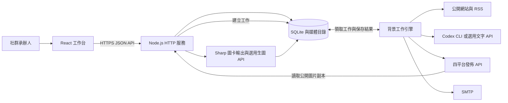
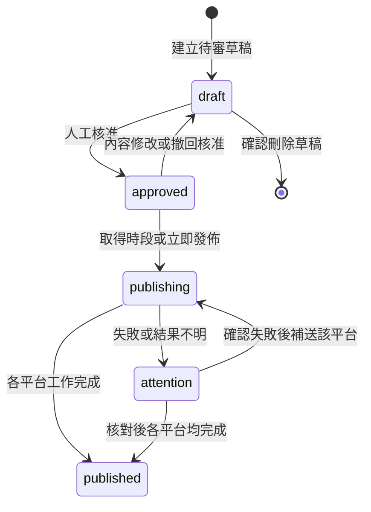

# 校園發聲｜AI 多平台社群發文系統

**資訊工程專案報告** · 2026-11-04

**評估範圍**為目前 `selfhost/` 自架版本，採原始碼檢視、隔離測試及本機服務檢查。舊版 Cloudflare／Sites 的成效追蹤功能另列於原有專案說明。

## 1. 摘要

學校與各單位的社群承辦人需要從網站、公告和活動資料整理內容，再依不同平台改寫文案、排版圖卡及安排發文。校園發聲把這些工作集中在單一網頁工作台，由 AI 整理待審草稿，承辦人核對後交給常駐主機排程。系統支援 Facebook 粉絲專頁、Instagram、Threads 與 LINE 官方帳號好友群發。

本專案的工程核心是維持內容審核與非同步發佈之間的一致性。系統用版本號處理多視窗修改，用內容雜湊綁定核准時的文案與圖片，並為每個平台保存個別發佈結果。本機已完成真實 Codex 產稿與 24 項自架測試。正式平台權限、圖片對外存取及 SMTP 投遞仍需在部署環境驗收。

## 2. 問題定義與設計範圍

| 需求 | 系統處理方式 |
| --- | --- |
| 減少重複整理與改寫 | 匯入貼上的文字、單篇公開文章、指定網站或 RSS。依主題、關鍵字、文章時效及每週上限挑選素材 |
| 四平台內容各自適配 | 一份素材建立四版繁體中文文案。正文預設 200～300 字，包含背景、重點與總結 |
| 保留承辦人的編輯控制 | 預覽、改寫、調整圖片順序及圖卡版面，核准後才進入發佈佇列。待審草稿可刪除，來源與圖庫保留 |
| 週期發文可持續運作 | 常駐主機依台北時區執行排程，一般稿優先，必要時使用仍有效的核准備稿 |
| 每個單位獨立管理 | 每個單位可部署自己的服務、資料庫、素材與平台憑證。每套有一個管理者帳號 |

## 3. 系統架構

以單一主機上的模組化應用程式部署。HTTP 服務、背景工作與 SQLite 共用資料模型，背景程序可隨 Web 啟動，也可在同一主機獨立執行。

| 層級 | 技術與責任 |
| --- | --- |
| 前端 | React、TypeScript、Vite。提供素材管理、各平台預覽、圖卡編輯、審核、排程與發佈紀錄 |
| HTTP API | Node.js 原生 HTTP 與 Zod。處理登入、資料驗證、狀態變更、靜態前端與圖片存取 |
| 資料與工作 | `node:sqlite`、WAL、交易及租約。文字與狀態保存在 SQLite，圖片存於主機媒體目錄 |
| 外部整合 | Codex Web Search 擷取公開網頁與訂閱來源，Sharp 轉換圖片，Codex CLI 產稿，Nodemailer 寄信，平台轉接器處理 API 差異 |
| 部署 | Docker Compose 管理應用程式與資料卷。正式對外部署可由 Caddy 提供 HTTPS 反向代理 |

這個部署方式適合單位型工作量。管理者只需維護一套主機與備份，排程與發佈紀錄也能在同一個資料庫交易中建立。背景工作與 HTTP 預設共用程序，主機停機或 CPU／記憶體飽和會同時影響兩者。跨主機備援與多租戶授權需要另行設計。

[前端](../selfhost/web/main.tsx) · [HTTP 服務](../selfhost/server.mjs) · [背景引擎](../selfhost/engine.mjs) · [部署設定](../compose.selfhost.yaml)

## 4. 資料模型與一致性

| 資料 | 用途與關聯 |
| --- | --- |
| `sources`、`articles` | 保存訂閱來源、標準化文章網址、來源摘要或手動貼入的原文、引文、日期及圖片候選。文章網址設唯一約束，用於匯入去重 |
| `generation_jobs` | 記錄來源文章、產稿要求及等待、執行、完成或失敗狀態 |
| `posts` | 儲存來源文章 ID、四平台文案、圖片排序、有效期限、是否備稿與核准狀態。`version` 控制並行修改 |
| `media` | 保存圖片尺寸、檔案識別與公開狀態。圖卡另存可重編輯的版面配方及原圖參照 |
| `slots`、`publications` | 排程時段以 ISO 時間作為主鍵。每篇貼文每平台最多一筆發佈工作，以 `(post_id, channel)` 唯一約束保護 |
| `sessions`、`secrets`、`leases`、`outbox` | 保存登入工作階段、憑證、背景程序租約及待寄郵件 |

貼文的 `reviewHash` 是對標題、各平台文案、圖片順序、平台、來源 ID 與有效期限計算的 SHA-256。修改其中一項會撤回核准，排程挑選及發佈前也會比對雜湊。版本號解決的是「其他視窗已更新」的競爭，雜湊解決的是「核准的內容是否仍然相同」。兩項檢查各有不同用途。

排程在 SQLite 交易內建立時段、更新貼文狀態及新增各平台工作。資料庫保存進度，程序重啟後能依既有狀態接續。外部 HTTP 發佈請求在交易之外執行，因此存在平台接受請求後、本機還未記錄結果就中斷的時間差。遇到這種情況，系統保存 `unknown` 並交由承辦人核對。

[資料表與交易](../selfhost/store.mjs) · [雜湊與選稿規則](../selfhost/core.mjs) · [發佈狀態處理](../selfhost/engine.mjs)

## 5. 主要工作流程

### 素材擷取與 AI 產稿

1. 以 HTTPS 抓取公開來源，解析 HTML／RSS，保留原文及出處。網站擷取使用同站連結篩選及可調整的 CSS 選擇器。需要登入或主要依賴 JavaScript 載入的頁面，可改由承辦人貼入原文。
2. 背景引擎依時效、關鍵字及每週自動產稿上限建立工作。以原文、受眾與語氣作為模型輸入，取得四平台文案、圖卡標題與摘要，以及主題配圖描述。
3. 以 JSON Schema 和 Zod 驗證結構。正文計數含標點，排除空白、網址及獨立 hashtag。字數越界時以同一服務修訂一次，仍未達標則保留失敗原因供人工處理。
4. Codex 模式以主機的 ChatGPT 登入執行固定參數的 `codex exec`。額度或授權錯誤會暫停 AI 產稿，發佈工作依自己的佇列繼續。選用付費 API 時，每次請求前先做預算保留，實際計費以提供者紀錄為準。

### 圖文卡片與審核

圖卡的背景、標題、摘要及單位註記分層處理。瀏覽器預覽與伺服器匯出共用版面邏輯及 SVG 疊字，支援方形、直式與橫式。匯出建立新 JPEG，並保留原圖和版面配方。承辦人可使用上傳或匯入的圖片。網站自動生圖透過選用的 Images API，需要另行設定 API 金鑰。

### 週期排程與多平台發佈

背景引擎以約 15 秒為預設檢查間隔，來源整理、產稿、發佈與郵件各有執行迴路。台北時區的設定轉成具體時段後，依序挑選有效的一般核准稿及備稿。空佇列記錄為略過並排入通知，超過補送期限的舊時段記錄為錯過。

| 平台 | 發佈處理 |
| --- | --- |
| Facebook 粉絲專頁 | 文字走 Page feed，單圖走 Photos，多圖先準備圖片再提交貼文 |
| Instagram | 建立圖片或輪播容器，等待容器完成後發佈。圖文稿至少包含一張圖片 |
| Threads | 建立文字、圖片或輪播容器後發佈。發佈前檢查全文長度 |
| LINE 官方帳號 | 文字搭配單圖或 Flex Carousel 群發。以固定重試鍵協助處理重複請求，保存 LINE 接受群發的結果 |

同一時段的各平台工作可並行，每個平台的成功或失敗分別持久化。承辦人可以核對不明結果並補送已確認失敗的平台。LINE 的成功紀錄代表請求被接受，好友端的實際送達是另一層結果。

[來源擷取](../selfhost/network.mjs) · [AI 產稿](../selfhost/ai.mjs) · [圖片處理](../selfhost/media.mjs) · [平台轉接器](../selfhost/publish.mjs)

## 6. 安全、部署與維運

| 風險面 | 目前的控制方式與邊界 |
| --- | --- |
| 工作台存取 | 使用 scrypt 保存加鹽密碼雜湊。登入狀態使用 HttpOnly、SameSite Cookie，正式 HTTPS 設定另加 Secure。伺服器檢查來源及登入嘗試次數 |
| 平台憑證 | 資料庫內的 Token 以 AES-256-GCM 加密，使用主機的 `machine.key` 解密。環境變數可覆蓋資料庫設定。前端狀態只回傳憑證存在與否 |
| 來源網址 | 檢查協定、DNS 與 IP 範圍，連線時使用已驗證的 IP。重新導向重新檢查，並設定大小及逾時限制，以降低 SSRF 風險 |
| AI 輸入 | 將擷取內容當作資料放入提示。Codex 子程序使用獨立暫存目錄與受限設定，清除指定類別的服務憑證環境變數。生成結果先驗證，再交人工審核 |
| 圖片公開 | 原始素材透過登入後的 API 讀取。貼文進入發佈準備時，建立平台規格的 JPEG 副本供平台抓取。公開副本目前以資料庫旗標及檔名管理 |
| 備份與郵件 | SQLite 快照、圖片目錄及 `machine.key` 一併備份。郵件透過 outbox 保存、去重並記錄寄送結果。SMTP 使用 TLS 設定 |

本機測試服務位於 `127.0.0.1:5180`。Linux 部署需準備資料卷、管理帳號、網域和 HTTPS，並在實際主機完成 Codex 登入。社群帳號使用手動設定的 Token，例行維運需追蹤效期及權限變更。

[自架部署與備份指南](selfhost-deployment.md) · [四平台憑證取得指南](social-api-setup.md)

## 7. 測試與成果

| 驗證項目 | 證據與結果 |
| --- | --- |
| 本次自架測試 | **24／24 通過**。涵蓋登入與 HTTP 流程、草稿刪除保護、版面重編輯、排程選稿、防重送、部分成功、來源限制、郵件與備份 |
| 既有領域測試及型別 | **6／6 通過**，`npx tsc --noEmit` 通過。六項屬既有領域測試，與自架測試分開統計 |
| 本機服務 | `GET /api/health` 回傳服務可用且管理者已設定。這項檢查驗證 HTTP 服務存活 |
| 真實 AI 產稿 | 既有驗證記錄中，以本機 Codex 訂閱登入完成單篇來源的四平台產稿。正文為 **270、270、270、282 字**。這組結果適用於該測試素材 |
| 容器及介面 | 既有記錄涵蓋 Linux Docker 測試、映像建置、繁中圖卡匯出、桌面與窄螢幕操作檢查 |
| 正式環境待驗收 | 目標 Linux 主機、四平台實際單圖與多圖發佈、LINE 群發與配額、SMTP 真實投遞、選用付費生圖 |

本次使用的命令為 `npm run selfhost:test`、`node --test tests/domain.test.mjs` 與 `npx tsc --noEmit`。社群及郵件自動化測試以受控替身驗證程式行為。正式發佈的授權、圖片抓取及外部結果仍應逐平台核對。

[測試程式](../selfhost/tests/) · [歷次驗證紀錄](validation.md)

## 8. 工程評估與下一階段

1. **優先完成正式端到端驗收。** 在目標主機以有權限的測試帳號驗證文字、單圖與多圖，對照平台內容、外部識別碼與本機紀錄。LINE 使用測試官方帳號驗證群發，並核對計費訊息量。SMTP 確認實際收件。
2. **修正純文字路徑的圖片網址依賴。** 本次以空圖片清單呼叫 `mediaForPlatform()`，在未設定 `PUBLIC_BASE_URL` 時重現 `503`。原因是該函式在檢查清單前先檢查網址，所有發佈工作又都會呼叫它。可讓空清單直接回傳空陣列，並分別驗證純文字、含圖片與 Instagram 缺圖三種行為。[圖片處理](../selfhost/media.mjs) · [發佈流程](../selfhost/engine.mjs)
3. **補足憑證與公開媒體的生命週期。** 增加 Token 到期提醒及更新驗證，設計公開圖片副本的保留與撤下政策。先確認平台何時會讀取圖片，再設定適合的公開期限。[平台轉接器](../selfhost/publish.mjs) · [公開圖片路由](../selfhost/server.mjs)
4. **量測工作量後再調整資料層。** 目前多處會讀取整張資料表後在 JavaScript 篩選，前端約每 15 秒取一次工作台狀態。可先量測資料累積時的 API 回應時間、排程延遲、佇列深度及備份還原時間，再決定是否分頁、加索引或拆分服務。[資料存取](../selfhost/store.mjs) · [工作台輪詢](../selfhost/web/main.tsx)

目前版本已把素材整理、人工審核、發佈佇列與結果追蹤串成可操作的本機工作流。下一個工程里程碑是讓同一套流程在單位的 Linux 主機與實際社群帳號完成端到端驗收，再依量測結果決定維運與擴充範圍。

## 2026-11-06 版本增補

已修正第 8 節記錄的純文字路徑問題，空圖片清單直接回傳。另加入可檢查的自動化規則、指定產稿時段、語意選稿、素材封存、分類分頁與依 API 設定限制發佈平台。更新後自架測試為 33 項，詳見 [驗證紀錄](validation.md) 與 [自動化規則](automation-policy.md)。
