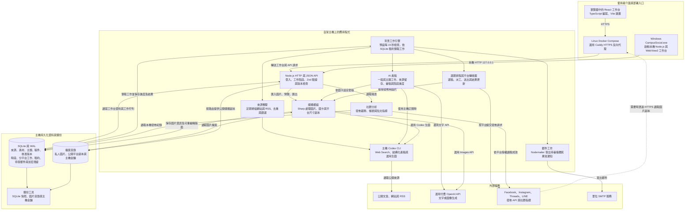
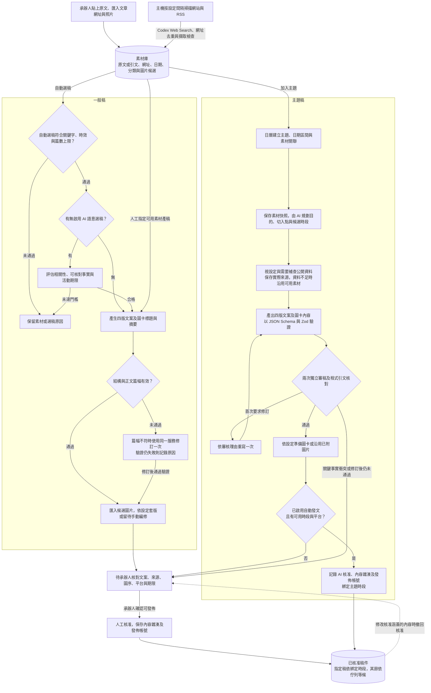
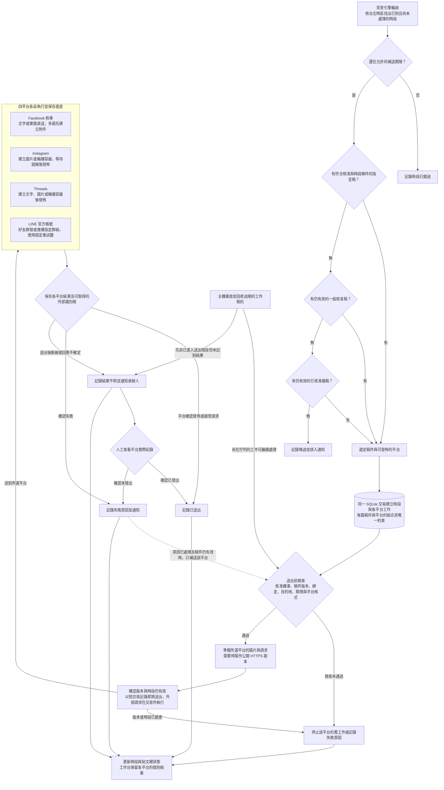

# 校園發聲專案報告規劃草稿

**建議讀者**　校方主管、社群承辦人與資訊工程評審。正式稿建議以前後各約四頁為目標。前半以校園活動公告說明讀者與承辦人的需求，後半沿用同一案例，說明系統如何保留來源、核對稿件、安排發文及處理異常。

## 前半部　專案價值

### 1. 校園公告從發布到被讀懂

一份活動簡章通常要經過摘錄、改寫、做圖與排程，才能成為 Facebook 粉絲專頁、Instagram、Threads 或 LINE 官方帳號上的貼文。四個平台的版面與閱讀習慣不同，活動日期、地點和報名方式卻必須一致。校園發聲把這些工作集中到一個工作台，讓承辦人掌握各版內容，也讓學生和家長更容易找到參加活動所需的資訊。 [第一版需求](requirements.md)

### 2. 用修理工作坊走一遍承辦流程

以虛構的校園修理工作坊為例。承辦人建立主題，匯入簡章和照片，系統依素材產出各平台文案。正式稿可以並列 Facebook 與 LINE 的示意稿。Facebook 用一段話說明親子會動手練習什麼，LINE 把日期、地點與報名連結放在容易掃讀的位置。圖卡提供活動名稱和重點，貼文文字保留完整的參加資訊。承辦人在工作台核對來源與圖片，選擇要發的管道並確認時段。 [主題日曆規格](v1-topic-publishing-spec.md) · [修理工作坊試讀情境](v1-blind-reading-rubric.md)

### 3. 承辦人如何掌握內容與發文節奏

一般稿由承辦人編輯、核准後交給常駐主機排程。單位可另外啟用主題自動發文，讓符合審核與排程條件的主題稿到點送出。承辦人仍可檢視、修改或鎖定主題稿。平日時段可由有效備稿補位，有發佈異常時可回到工作台查閱個別平台結果。發佈後，社群分析可協助回顧近 7、30、90 天的發文節奏，並在平台授權與資料可用的情況下查看帳號及貼文成效。 [工作流程](system-workflow-and-technology.md) · [主題日曆規格](v1-topic-publishing-spec.md) · [社群分析報表](../selfhost/analytics-report.mjs)

### 4. 用讀者試讀檢查內容品質

正式稿可沿用既有匿名試讀設計。以相同素材準備現行流程稿與系統稿，請目標讀者讀完後回答「活動在做什麼」「何時、何地舉行」「如何報名」。承辦人另行核對日期、地點、來源和單位語氣，判定各稿是否可發佈。減少重複整理是預期效益，現有試讀規劃以讀者理解與稿件品質為主要驗收項目。 [讀者問卷](v1-blind-reading-participant.md) · [主持與評分表](v1-blind-reading-rubric.md)

## 後半部　資訊工程技術

### 5. 系統架構與部署方式

以目前自架版為主。React、TypeScript 與 Vite 提供工作台，Node.js HTTP 服務處理登入、資料驗證與操作請求。SQLite 保存素材資料、稿件版本、時段和發佈工作，圖片檔案另存於主機。背景工作引擎從資料庫領取工作，執行來源整理、AI 產稿、發佈與郵件寄送。Linux 常駐部署使用 Docker Compose，可透過 Caddy 提供 HTTPS。Windows 桌面啟動器使用 WebView2 顯示工作台。 [工作台](../selfhost/web/main.tsx) · [HTTP 服務](../selfhost/server.mjs) · [資料庫](../selfhost/store.mjs) · [部署指南](selfhost-deployment.md) · [Windows 啟動方式](../README.md#windows-一鍵啟動)

#### 圖 1　自架系統架構與資料流

背景引擎可與 HTTP 服務一起啟動，也可在同一主機另開工作程序。兩種方式皆使用 SQLite 租約協調同類工作。工作台保存的服務憑證以 AES-256-GCM 加密，解密所需的主機金鑰隨備份工具保存。 [引擎](../selfhost/engine.mjs) · [獨立工作程序](../selfhost/worker.mjs) · [資料儲存](../selfhost/store.mjs) · [備份工具](../selfhost/backup.mjs)

### 6. 公開來源、AI 審稿與圖卡輸出

系統可接收貼上的原文、文章網址或網站訂閱。公開網頁由主機的 Codex Web Search 取得，保留網址與可供核對的片段。自動選稿先依關鍵字、時效與篇數限制篩選。產稿輸出以 JSON Schema 和 Zod 驗證。主題稿依序保存來源、規劃、搜尋、產稿與審稿結果，重啟後可從已保存的階段接續。審稿與產稿分開執行，後端再確認引用能對回保存的證據。若工作坊簡章與補充來源的日期有衝突，稿件應留給承辦人確認。圖卡則保存原圖和版面設定，由 Sharp 匯出發佈用圖片。 [來源擷取](../selfhost/codex-web.mjs) · [產稿驗證](../selfhost/ai.mjs) · [主題稿流程](../selfhost/topic-drafts.mjs) · [圖卡輸出](../selfhost/media.mjs)

#### 圖 2　從素材匯入到稿件核准

主題產稿每個階段都保存進度與版本，重啟可接續最後已保存的階段。換稿最晚須在發文前 24 小時開始，候選版通過審核後才取代原稿。到了發文時間，候選版仍在處理時，系統保留仍有效的原稿。關鍵素材修正時，受影響的稿件會暫停發佈並重新核對。 [主題日曆規格](v1-topic-publishing-spec.md) · [自動選稿規則](automation-policy.md) · [產稿與換稿實作](../selfhost/topic-drafts.mjs)

### 7. 核准版本、發文佇列與異常復原

版本號用來攔截多視窗的過期修改。內容雜湊則將核准與當時的文案、圖片順序、平台和來源等欄位綁定，送出前再次核對。背景引擎依台北時區領取時段，優先採用仍有效的指定稿，其次為一般核准稿，再其次為有效備稿。SQLite 交易建立時段和各平台工作，並以每篇稿件與平台的組合限制重複建立。外部平台可能已收件，但主機在記錄結果前中斷。這類工作會標為結果不明，由承辦人查證，確認未發出後才能補送。 [核准與選稿規則](../selfhost/core.mjs) · [資料表約束](../selfhost/store.mjs) · [背景發佈引擎](../selfhost/engine.mjs)

#### 圖 3　從排程選稿到四平台發佈與復原

例如工作坊貼文已在 Facebook 發出，但 LINE 的請求逾時，工作台會保留 Facebook 的成功紀錄，並把 LINE 標為結果不明。承辦人確認 LINE 沒有發出後，才可對該平台提出補送。LINE 回應接受請求時，系統記錄的是 API 接受結果。 [平台轉接器](../selfhost/publish.mjs) · [發佈與人工核對 API](../selfhost/server.mjs)

### 8. 驗證結果與正式部署條件

**本機自架測試。** 2026-11-25 執行 `npm run selfhost:test`，75 項全數通過。正式稿可選改期後攔截舊稿、主機重啟接續工作、平台部分成功與結果不明三個案例，寫出各自的預期行為。 [自架測試](../selfhost/tests/)

**外部平台與 AI 紀錄。** 2026-11-15 已驗證 Facebook 測試專頁的純文字排程發文與公開可見性。修理工作坊的既有驗收另有真實 Codex 產稿，並用模擬 LINE 端點驗證到點送出及再次執行時沒有重送。 [驗證紀錄](validation.md)

**正式環境。** 指定 Linux 主機、正式網域與 HTTPS，以及單位持有的四平台帳號、圖片發佈與 SMTP 信件，仍以目標部署環境的實際驗收為準。 [部署與驗收指南](selfhost-deployment.md)
