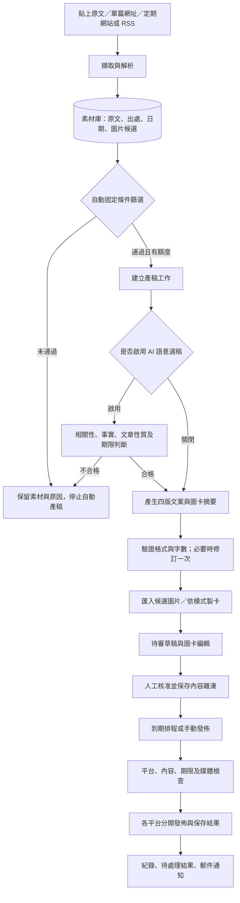

# 系統完整流程、擷取規則與技術對照

核對日期：2026-11-07。範圍為目前 `selfhost/` 自架版本。依原始碼與本機資料庫的非機密設定整理；本次未修改運作設定或執行對外發佈。

## 1. 目前實際啟用的設定

| 項目 | 本機目前設定 | 實際意義 |
| --- | --- | --- |
| 文字 AI | Codex；AI 啟用 | 背景程序透過固定參數執行主機已登入的 Codex CLI |
| 來源整理 | 每 120 分鐘 | 以距離上次開始整理的間隔判斷；可手動立即整理 |
| 自動產稿時機 | 來源整理後 | 目前沒有啟用指定每日產稿時段 |
| 指定產稿時段 | 已存週一至週五 08:30、15:00 | 只有切換成指定時段並儲存後才生效 |
| 自動產稿上限 | 每日 2 篇、每週 5 篇 | 計算自動嘗試，包含略過與失敗；取消工作不計 |
| 主題詞／包含詞／排除詞 | **全部空白** | 功能存在，目前沒有以這些詞限制選稿；沒有內建預填的排除詞庫 |
| 選稿時效 | 30 天 | 優先由來源發佈日計算，沒有日期改用擷取日 |
| 自動選稿原文下限 | 去除空白後 200 字元 | 與網頁解析的 80 字元最低門檻不同 |
| AI 語意選稿 | **關閉** | 70 分、3 個事實是已存門檻，目前不執行這一道 AI 評估 |
| 四版正文 | 每版 200～300 字 | 含標點；排除空白、網址與獨立 hashtag |
| 自動作圖模式 | **人工選圖製卡** | 目前不會隨自動產稿直接生成 AI 圖卡 |
| AI 生圖開關 | 開啟 | 2026-11-07 新增服務選擇，預設 Codex 訂閱生圖；選用 API 生圖才需 API 金鑰。仍須實際要求生圖或選擇自動 AI 圖卡模式 |
| 對外發佈排程 | 每週一 10:00，台北時間 | 需要有效核准稿、設定齊全的平台憑證及通過發佈檢查 |
| 自動封存 | 擷取後 90 天 | 在來源整理時執行維護；保留資料，不永久刪除 |

目前來源設定：

| 名稱 | 網址 | 類型 | 啟用 | 連結包含條件 | 正文 CSS 選擇器 | 預設分類 |
| --- | --- | --- | --- | --- | --- | --- |
| 商業週刊 | https://www.businessweekly.com.tw/ | 網站 | 是 | 空白 | 空白 | 其他 |
| dyu | https://dyuerstv.blogspot.com/ | 網站 | 是 | 空白 | 空白 | 其他 |

因此，目前來源會使用通用 HTML 規則。尚未針對兩站設定精準的文章路徑與正文區域，也未啟用 AI 判別列表頁／廣告內容。正文足夠長的分類頁仍可能進入候選。

## 2. 整體資料流



手動選素材要求產稿走另一個入口：承辦人已選定來源，所以不套用自動選稿的主題、時效、字數與每日／每週嘗試門檻，也不執行自動語意選稿。封存素材仍禁止產稿；輸出文案仍須通過格式與字數驗證。

## 3. 素材如何取得

### 3.1 三種入口

1. **貼上原文**：直接保存承辦人提供的標題、內文、選填網址與分類，沒有網頁抓取。內文輸入限制為 20～24,000 字元。
2. **匯入單篇網址**：直接讀取該 HTML 頁面，不先走文章列表連結探索。
3. **定期來源**：讀取已啟用的網站列表或 RSS／Atom，再從新連結擷取文章。

### 3.2 網頁擷取

工作台透過主機上已登入的 Codex CLI，使用即時 Codex Web Search 讀取公開 HTTPS 網頁。原始網址、公開查詢詞和頁面內容都視為資料。抓取流程僅開啟 Web Search，並由工作台核對 Codex 實際開啟的頁面網址。

1. **網站列表與 RSS／Atom**：Codex 開啟訂閱網址、擷取文章連結。網站列表只採用同主機網址，RSS／Atom 可採用訂閱項目指向的外站文章。網站列表不可讀時，可改用同主機公開搜尋並驗證實際開啟的文章。工作台套用網址包含條件、去重，每來源每輪最多送讀 8 篇新網址。
2. **單篇文章**：保存來源網址、標題、可核對的摘要與短引文。日期及圖片須由來源明確提供。CSS 選擇器保留為正文定位提示。只有搜尋摘要、登入牆或無法讀到正文的頁面，可改貼原文。
3. **時事與熱門梗**：使用獨立查詢，搜尋後逐頁開啟候選來源。逐字查核只使用保存的短引文，並另核對熱度證據與來源日期。
4. **匯入圖片**：選定圖片後，主機另以 HTTPS 取得檔案位元組，檢查公開 IP、重新導向、檔案格式及大小。

## 4. 排除詞、包含詞與去重究竟怎麼做

### 4.1 排除詞是「選稿排除」，不是「阻止下載」

順序是：**先讀取既有公開頁面 → 保存摘要、引文與來源 → 依條件標示是否可供自動產稿**。命中排除詞的內容仍可存在素材庫，不會因此永久刪除。若要避免抓取某種網址，需要另外的連結規則；目前只有可選的網址包含條件。

設定入口為「單位設定 → 單位識別與選題方向」。主題、包含詞及排除詞可使用半形逗號、全形逗號或換行分隔。

```text
檢查文字 = 標題 + 原文，轉成小寫
若包含任一排除詞 → 不通過
否則，若主題詞與包含詞全空白 → 通過關鍵字檢查
否則，包含任一主題詞或任一包含詞 → 通過
其餘 → 不通過
```

- 排除詞優先。
- 主題詞與包含詞合併為 **OR** 條件，不是兩欄都要符合。
- 純子字串比對，不區分英文大小寫；沒有斷詞、同義詞擴展、正規表示式或語意推論。
- 檢查整段抽出的內文；若夾帶推薦文章或廣告，也可能誤觸排除詞。

例如填入主題 `研究成果,學生競賽`、包含詞 `獲獎`、排除詞 `業配,付費課程`：任一前三者出現即可，但只要有任一排除詞仍不通過。此為邏輯示例，本次沒有套用到系統。

### 4.2 去重的兩層

1. **網址去重**：標準化後的文章網址在資料庫設唯一約束，避免同網址重複保存。
2. **原文去重**：將新文章與既有原文都去掉空白後比較，完全相同時記錄 `duplicateOf`，不自動選稿。

目前沒有相似度向量搜尋或跨站近似新聞聚類。同一篇報導改寫幾句，仍可能視為不同素材。同網址後續更新的文章也不會自動重抓更新版本。

已標為 `filtered` 的舊素材不會因修改包含詞而自動重新分類為 `available`；自動派工目前從可用素材集合挑選。人工選定素材要求產稿是另一條流程。

## 5. 從素材到 AI 草稿

### 5.1 固定條件與工作佇列

自動候選依**擷取時間由新到舊**，逐篇確認：

- 未封存、不是完全相同原文的重複來源。
- 通過主題／包含詞／排除詞檢查。
- 未超過素材有效期限。
- 原文去除空白後至少 200 字元。
- 尚無產稿工作紀錄；過去失敗的工作也不會自動無限重試。
- 今日及本週仍有自動嘗試額度。

符合條件才在 SQLite 建立 `generation_jobs`，依等待、執行、完成、略過或失敗記錄進度。建立工作時保存部分規則快照；執行時再次按當時設定檢查自動工作。SQLite 條件更新避免同一工作被重複領取。

### 5.2 選用 AI 語意選稿

開啟後才多做一次模型呼叫，輸入受眾、關注主題、選稿規則、目前時間與原文，輸出結構化結果：

| 欄位 | 用途 |
| --- | --- |
| `eligible` | AI 是否認為可採用 |
| `score` | 0～100 相關性分數 |
| `category` | 六種固定分類之一 |
| `reason` | 採用或略過理由 |
| `facts` | 從來源整理的可核對事實 |
| `expiresAt` | 明確活動期限，沒有則留白 |

程式再驗證至少 70 分、至少 3 個去重後事實條目、期限仍有效。事實去重採字串去重，不是另一輪語意辨識。AI 說可用，也不能跳過這些程式門檻。結果保存在素材，可供承辦人檢查。

這是基於擷取原文的判斷，沒有另外搜尋外部來源查證；「可核對事實」表示列出可回到原文核對的內容，不表示已由第三方驗證。

### 5.3 Codex 整合及產稿驗證

後端使用 Node.js `child_process.spawn` 執行固定的 Codex CLI 參數，以 stdin 傳入提示；不是讓網頁輸入任意 shell 指令。固定設定採 ChatGPT 登入、唯讀沙箱、臨時工作階段、停用 shell／apps／plugins；子程序環境移除指定服務憑證類變數。

每次請求設 180 秒逾時，要求 JSON Schema 結構，再以 Zod 驗證輸出。保存四平台文案、圖卡短標題、圖卡摘要與無字配圖描述。正文用共用函式計數，不在前後端各寫不同算法；字數不合格時要求同一服務修訂一次，仍不合格則工作失敗。

| 平台 | 文案提示方向 |
| --- | --- |
| Facebook | 背景與影響、具體重點、總結與來源 |
| Instagram | 資訊型首句、短段落、重點整理、少量相關 hashtag |
| Threads | 單一觀察、具體事實與總結；另外限制全文長度 |
| LINE | 標題、重要日期／對象／地點、單一行動與來源 |

表達方向依模型提示，程式硬性驗證結構及字數，不代表每句事實都已自動查證。來源日期與事件日期要求分開處理，過去事件應寫成回顧，最後仍經人工審核。

Codex 授權或額度錯誤會暫停 AI 工作並保存原因，不會自動改走付費文字 API。網站另外實作選用文字 API 與生圖 API；它們有獨立金鑰與本機預算保留設定。

## 6. 圖片與圖卡

### 6.1 來源照片

擷取文章時先記錄最多 10 張候選網址；產稿時才嘗試下載並匯入圖庫。下載失敗保留文案，不因此丟掉整份草稿。

目前擷取規則不會自動確認照片授權、辨識是否為該事件現場或驗證人物；也沒有影像語意配對。`og:image` 可能是網站共用圖。來源照片需人工確認後選用。

圖片輸入最大 10 MB、解碼像素上限 4,000 萬；使用 Sharp 旋轉校正、縮至 2,400×2,400 範圍、白底處理及轉 JPEG，使用 UUID 命名。

### 6.2 三種作圖方式

| 模式 | 工作內容 |
| --- | --- |
| 人工選圖製卡（目前） | 產生文案與圖卡文字，承辦人在編輯器挑背景、調整文字、排版及匯出 |
| 自動品牌套版 | 用品牌色底圖加標題與摘要；不自動把未確認的來源照片當底圖 |
| 自動 AI 圖卡 | 使用所選 Codex 訂閱或 Images API 生成主題無字概念背景，再以程式疊字，保存可編輯配方 |

圖卡編輯器用 React 操作 JSON 配方，記錄原圖 ID、標題、摘要、位置、字級、顏色、遮罩與裁切縮放。瀏覽器預覽和伺服器共用版面／SVG 邏輯，後端使用 Sharp 合成 JPEG。重新編輯讀回配方，匯出建立新圖片，保留原始素材。

提供方形 1080×1080、直式 1080×1350、橫式 1200×630。發佈時另製平台圖片：Facebook／Threads 1080×1080、Instagram 1080×1350、LINE 1024×1024，以留白補齊方式保留已核准文字。

2026-11-07 新增 Codex 訂閱生圖程式：後端呼叫固定參數的 CLI 內建生圖工具，取得新生成圖片後匯入圖庫。預設選用 Codex，不會失敗後自動切換 API；Images API 仍為管理者可明確選用的服務。同日使用者要求測試後，已修正本機預覽來源檢查，並從網頁完成實際 Codex 生圖、匯入、加字及儲存圖卡。細節見 [Codex 生圖整合](codex-image-integration.md)。

## 7. 審核、平台設定與發佈

1. 草稿保存四版文案、圖序、來源、分類、期限及目標平台。承辦人核對原文、日期、圖片與授權。
2. 核准時，程式對標題、文案、圖片順序、平台、來源 ID、期限計算 SHA-256，保存 `reviewHash`。
3. 修改受雜湊保護的內容後需重新核准。貼文版本號用於發現多視窗覆寫衝突。
4. 建立／編輯貼文與手動發佈只提供必要 API 欄位填齊的平台；後端再次檢查。未設定 API 仍能產生四版文案與保存草稿，不能以空目標平台核准發佈。
5. 「欄位齊全」與「平台已驗證可發文」不同。另有唯讀連線檢查，正式仍需驗收 Token、權限、帳號類型與發文配額。尚未實作完整 OAuth 回呼與自動更新 Token。
6. 排程到時，挑選仍有效、雜湊相符且平台吻合的已核准稿，一般稿優先，再選備稿。沒有合適內容則略過並記錄。
7. 在同一 SQLite 交易建立時段與各平台工作。時段主鍵及 `(post_id, channel)` 唯一約束降低重複派工。
8. 發佈前再次檢查核准雜湊、有效期限、平台限制與圖片。圖片需主機公開 HTTPS 位址供外部平台下載。
9. 各平台分開保存成功、失敗或不明結果；成功平台不隨失敗平台一起重新送出。平台已可能收到而本機未確認時保留不明狀態，要求人工核對，不能宣稱完全 exactly-once。

| 平台 | 目前轉接技術 |
| --- | --- |
| Facebook 粉絲專頁 | Meta Graph API，feed／photos；多圖先準備圖片再提交 |
| Instagram | 經 Facebook Login 路徑的 Graph API，建立單圖／輪播容器，等候就緒後發佈 |
| Threads | Threads API，建立文字／圖片／輪播容器後發佈 |
| LINE 官方帳號 | Messaging API broadcast，文字、單圖或 Flex Carousel；保存穩定重試鍵 |

LINE 的成功是 API 接受群發請求，並非每位好友已閱讀或確定送達。四平台正式帳號發佈仍屬部署環境驗收項目。

## 8. 三種時間、資料期限及分類

背景引擎預設約每 15 秒檢查來源、產稿、發佈及郵件四類工作。時間精度受到工作耗時、網路與主機狀態影響；不是保證整點秒級執行的即時系統。

- **擷取時間**：現在為間隔 120 分鐘，不是每天固定兩個時刻。來源整理時逐站逐篇處理。
- **產稿時間**：現在是整理後派工；改成指定時段後才採週一至週五 08:30、15:00。指定模式只有約 15 分鐘內的逾時時段可派工。
- **發佈時間**：現在為每週一 10:00。預設補送期限為 30 分鐘，主機恢復時過舊的排程不補發。

所有週期以 `Asia/Taipei` 解讀。主機必須常駐，關機期間不會替使用者抓取或產稿。

素材選稿期限為「來源發佈日（無則擷取日）＋30 天」，AI 若確認較早的活動截止日則取較早值。新自動草稿帶入有效期限，手動草稿須人工確認。90 天是從擷取日起的封存期限，維護時若素材正在排隊／產稿會暫不封存。

封存保留原文、圖片及關聯，可還原，但還原不重設原日期。沒有素材永久刪除排程，也沒有圖庫／已公開媒體副本的自動到期清除。待審草稿可刪除；已有發佈紀錄的貼文保留。

分類固定為「校園新聞、活動公告、研究成果、招生資訊、國際交流、其他」。可由來源設定預設值、人工調整，或啟用 AI 語意選稿後由評估補上尚未分類的素材。

素材、待審稿、圖庫、發佈紀錄提供分類／時間範圍篩選、月份或分類分組、排序及每頁 12 筆。**目前為前端分頁**；`/api/state` 仍回傳完整集合，資料規模大時須再加入後端分頁、查詢與索引策略。封存改善預設展示，不等於降低全部資料傳輸量。

## 9. 功能與工程技術對照

| 使用者功能 | 對應技術 | 工程作用 | 主要檔案 |
| --- | --- | --- | --- |
| 網頁工作台與手機版 | React、TypeScript、CSS、Vite | 元件、互動、型別檢查、前端建置 | `selfhost/web/` |
| 登入與操作 API | Node.js 原生 HTTP、JSON API、Zod | 路由、驗證輸入、授權與錯誤回應 | `selfhost/server.mjs`、`selfhost/core.mjs` |
| 文章／網站／RSS 匯入 | Codex CLI、Web Search、結構化輸出 | 搜尋、讀取、來源追溯與欄位驗證 | `selfhost/codex-web.mjs` |
| 主題與排除詞 | 純字串規則 | 可重現且不需模型費用的固定篩選 | `selfhost/core.mjs` |
| 時效、篇數、封存 | 日期計算與政策函式 | 分開管理資料可用期、嘗試上限及展示生命週期 | `selfhost/automation.mjs` |
| AI 選稿及四版寫稿 | Codex CLI 子程序、提示、JSON Schema、Zod | 文字推論、結構化輸出、程式再驗證 | `selfhost/ai.mjs`、`selfhost/content.mjs` |
| 背景工作與排程 | 持久化佇列、輪詢、SQLite 租約與條件更新 | 非同步執行、重啟留存、避免重複領取 | `selfhost/engine.mjs` |
| 圖片匯入及輸出 | Sharp | 解碼、縮放、合成、轉檔、平台規格副本 | `selfhost/media.mjs` |
| 可重編輯圖卡 | JSON 版面配方、SVG、共用布局函式 | 分離背景與文字，預覽與匯出一致 | `selfhost/card-layout.mjs`、`selfhost/web/CardEditor.tsx` |
| 圖片生成 | Codex CLI 內建生圖，或選用 Images API | 生成無字背景，另行疊字；API 路徑才做美元預算保留 | `selfhost/codex-image.mjs`、`selfhost/media.mjs` |
| 人工審核 | 狀態機、SHA-256、版本號 | 將核准綁定特定內容，發現並行修改 | `selfhost/core.mjs`、`selfhost/server.mjs` |
| 四平台發文 | 平台轉接器、HTTP API、容器輪詢 | 封裝四平台流程差異與結果 | `selfhost/publish.mjs` |
| 原文、草稿、工作紀錄 | SQLite、WAL、交易、唯一約束 | 持久化、一致性與本機並行控制 | `selfhost/store.mjs` |
| 平台憑證保護 | AES-256-GCM、主機金鑰 | 加密資料庫內憑證；不表示整個資料庫皆加密 | `selfhost/store.mjs` |
| 帳密與工作階段 | scrypt、雜湊 session、HttpOnly／SameSite Cookie | 密碼雜湊、登入與瀏覽器工作階段保護 | `selfhost/server.mjs` |
| 通知與摘要 | Nodemailer、SMTP、outbox | 保存待寄任務、去重、受控重試 | `selfhost/mailer.mjs` |
| 自架與備份 | Docker Compose、Caddy、資料卷、SQLite 快照 | 主機部署、HTTPS、保存資料與還原 | `compose.selfhost.yaml`、`selfhost/backup.mjs` |

此自架版本採單位各自部署的模組化單體架構。根目錄保留早期 Next／Cloudflare 專案依賴，不代表目前自架服務同時使用這些框架承擔執行。

## 10. 檢查與調整入口

| 想檢查的規則 | 位置 | 目前要注意的事 |
| --- | --- | --- |
| 受眾、語氣、主題、包含詞、排除詞 | 單位設定 → 單位識別與選題方向 | 三種詞目前空白 |
| 擷取間隔、產稿時間、篇數、時效、AI 選稿、作圖政策 | 單位設定 → 自動化規則 | 可先做固定條件預覽；預覽不呼叫 AI，也不等於儲存 |
| 網站文章路徑與正文範圍 | 編輯來源 → 進階擷取設定 | 兩個來源目前皆空白，應逐站抽樣確認 |
| 對外發佈日與時刻 | 週期與日曆 | 目前每週一 10:00 |
| 平台憑證與連線檢查 | 平台 API 設定 | 欄位齊全後還要驗證權限與實際發佈 |
| 單篇原文、圖卡與有效期限 | 素材／待審稿編輯 | 自動判斷後仍可人工核對與調整 |

本文件描述目前行為。待補強重點為逐站精準擷取設定、列表頁辨識、近似去重、資料庫分頁與保留清理政策，以及正式外部平台／郵件驗收；本次沒有擅自啟用或更改這些設定。
